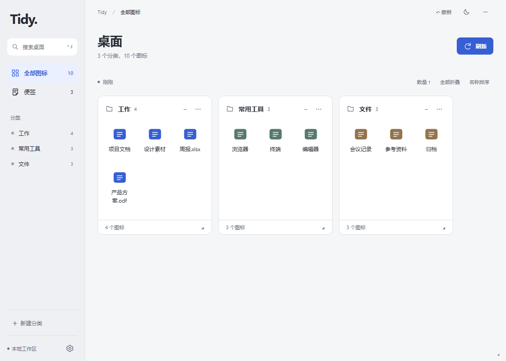
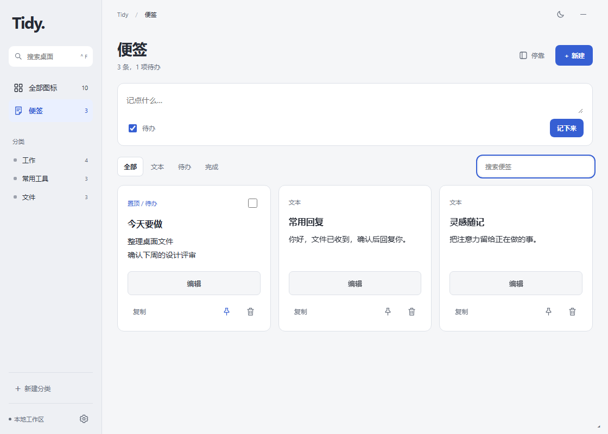
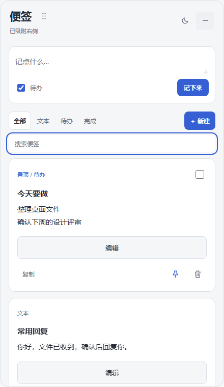
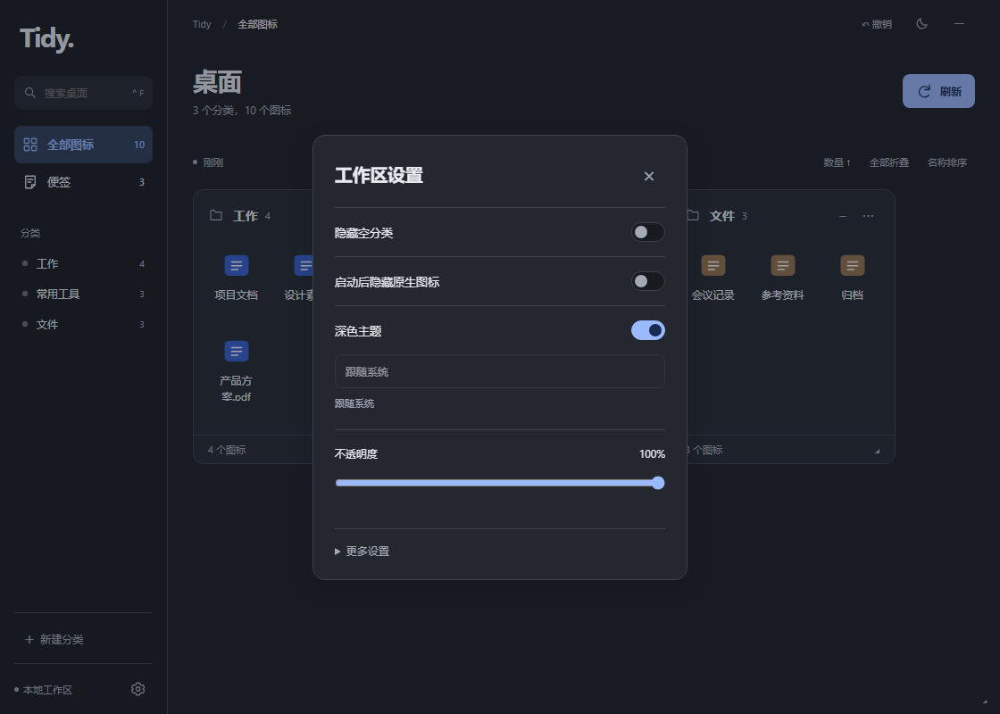

# Desktop Tidy · 桌面整理

轻量 Windows 桌面工具：整理图标，随手记录，让桌面保持清爽。

- **桌面分类**：自动识别、拖动归类、搜索和自定义布局，不移动桌面原文件。
- **本地便签**：速记、待办、置顶、搜索；独立的大阅读区和编辑区。
- **四边磁吸**：拖动便签顶部，在上下左右停靠；收起后保留边缘把手。
- **简约界面**：灰白 / 石墨双主题，跟随系统；低频设置按需展开。

当前处于预览阶段。下文介绍仓库当前实现，已发布 ZIP 的功能以对应 Release 说明为准。

## 界面预览



<details>
<summary>查看便签、边缘抽屉和深色设置</summary>







</details>

> 截图使用隔离的模拟桥接与虚构数据，不包含真实桌面文件或个人便签。

## 下载与运行

1. 打开 [Releases](https://github.com/KellonWww/desktop-tidy/releases)，下载发布页提供的 `win-x64.zip`，不要下载 Source code。
2. 将 ZIP **完整解压**到固定目录，例如 `D:/Apps/DesktopTidy`。
3. 双击 `DesktopTidy.exe`；保留同目录的配置、DLL 和 `Web/` 等随包文件。
4. 可为 EXE 创建快捷方式；运行不需要 Python 或开发工具。

| 项目 | 要求 / 说明 |
|---|---|
| 系统 | 64 位 Windows 10 / 11；主要在 Windows 11 验证，Windows 10 待验收 |
| 运行环境 | .NET Framework 4.8 或兼容更新版本；缺失时安装运行时，不是 Targeting Pack |
| 界面组件 | Microsoft Edge WebView2 Runtime |
| 桌面 | Windows Explorer 原生桌面；其他桌面替代软件未验证 |
| 权限 | 通常不需要管理员权限 |
| 分发 | 免安装 ZIP，不含测试程序、用户配置或桌面数据 |
| 签名 | 当前未签名；核对来源与 SHA-256，不要关闭系统安全防护 |

[.NET Framework 4.8 官方下载](https://dotnet.microsoft.com/download/dotnet-framework/net48)

下载后在命令提示符校验，并与发布页提供的 SHA-256 比对（将文件名替换为实际下载名称）：

```bat
certutil -hashfile DesktopTidy-latest-win-x64.zip SHA256
```

## 桌面整理

首次启动扫描桌面，默认保留原生桌面图标；如需只显示工作区，可在引导或设置中隐藏原生图标。

| 操作 | 使用方式 |
|---|---|
| 打开文件 | 双击图标；右键使用 Windows 原生菜单 |
| 自动分类 | 按应用名、目标、程序信息和网址识别，未知应用进入待分类 |
| 手动归类 | 将图标拖入分类，刷新保留归属；重新自动分类会清除手动归属，可撤销 |
| 调整布局 | 拖动分类标题排序，拖动边角调整大小；支持折叠、数量排序与名称排序 |
| 自定义分类 | 左栏「新建分类」；分类菜单支持重命名、删除 |
| 搜索 | 左栏按名称搜索，Ctrl+F 聚焦，Esc 清空搜索 |
| 撤销 | Ctrl+Z 撤销支持的布局 / 设置操作；输入框内保留文本撤销 |
| 工作区设置 | 左下角齿轮；主题、不透明度、原生图标显隐及更多设置 |
| 收起 / 恢复 | 右上角收起到托盘；托盘右键 → 显示分类窗口 |
| 完全退出 | 托盘右键 → 退出；退出时请求显示原生桌面图标并确认结果 |

应用识别使用本地规则，不联网、不上传图标、不启动目标程序。文件操作后自动刷新，未同步时可手动点「刷新」。

## 便签

### 记录、阅读与编辑

| 操作 | 使用方式 |
|---|---|
| 快速记录 | 在「记点什么…」输入，Enter 保存，Shift+Enter 换行；勾选「待办」记录任务 |
| 新建 | 点击「＋ 新建」，填写标题或正文后保存；标题可留空 |
| 阅读 | 列表显示两行摘要；点击正文或聚焦后按 Enter / 空格，进入大阅读区；Esc 返回 |
| 编辑 | 独立整行「编辑」按钮，与复制分行；大字号文本区，Ctrl+Enter 保存 |
| 复制 | 卡片下方「复制」，不会进入编辑 |
| 置顶 / 删除 | 卡片下方图标按钮，悬停查看说明；删除需确认，不参与 Ctrl+Z |
| 查找 | Ctrl+F 搜索标题与正文；支持全部 / 文本 / 待办 / 完成筛选 |
| 完成任务 | 勾选完成；「全部」默认折叠已完成项，可展开；搜索包含匹配的已完成项 |
| 恢复草稿 | 编辑器「关闭」保留草稿，点击「继续编辑」恢复；「放弃草稿」主动丢弃 |

速记框聚焦后展开。正式便签需要保存；未保存内容随输入备份到本机，关闭或重启后可恢复。
工作区与抽屉共享已保存便签，草稿分别保留；遇到同步冲突，可查看新版、复制自己的草稿或另存，不覆盖另一处修改。

### 四边磁吸与收起

- **换边**：拖动抽屉顶部标题或拖动图标，松手吸附当前屏幕最近的上 / 下 / 左 / 右边缘；拖动中显示目标，Esc 取消。
- **识别位置**：抽屉标题下显示当前停靠边；收起后边缘保留圆角把手，箭头朝向呼出方向。
- **呼出 / 收起**：点击把手或悬停呼出，默认延迟 0.6 秒；移开约 0.6 秒自动收起，也可点击右上角「−」。
- **偏好**：便签页「停靠」中设置开关、0.3 / 0.6 / 1 秒延迟、全部 / 主屏 / 指定屏幕，以及本次运行暂停。
- **暂停与关闭**：暂停只禁用悬停，仍可点把手打开；关闭停靠功能隐藏把手，仍可从托盘「打开边缘便签」。
- **交互保护**：阅读、编辑、删除确认、速记聚焦及保存期间不自动收起；全屏应用前台时暂停自动呼出并隐藏把手。
- **位置记忆**：重启恢复停靠边与屏幕；屏幕断开时回退至允许的可用屏幕，不挤占分类区。
- **动画**：拖动、弹出、收起与吸附采用连续动画，仅运动期间启用高精度调度；关闭系统动画时直接切换。

展开不抢焦点，点击后可输入。混合 DPI 多屏、全屏游戏和长期驻留表现仍需人工验收。

## 数据与安全

| 数据 | 本机位置 |
|---|---|
| 已保存便签 | `%LOCALAPPDATA%/DesktopTidy/notes.json`；上次备份 `notes.json.bak` |
| 未保存草稿 | `%LOCALAPPDATA%/DesktopTidy/WebView2/`；抽屉使用其 `NotesEdge/` 子目录 |
| 布局、撤销、图标位置快照 | `%LOCALAPPDATA%/DesktopTidy/Workspace/` |
| 错误日志 | `%LOCALAPPDATA%/DesktopTidy/Prototype/error.log`，发生错误时生成 |
| 主题与停靠偏好 | 当前用户注册表 `Software\DesktopTidy\Preferences` |

便签最多 200 条，每条标题 80 字、正文 2000 字；读取异常时保留原文件并禁止覆盖，请先备份再排查。
草稿不在 `notes.json.bak` 中，清除 WebView2 用户配置会丢失草稿；备份失败时会提示并阻止直接关闭未保存的编辑器。

**文件保护边界：**
- 分类、排列与显隐不会移动或删除桌面原文件；Windows 右键菜单中的重命名、删除会操作真实文件。
- 删除优先移入回收站，无法回收时由 Windows 确认；删除快捷方式不会卸载程序。
- 文件删除、重命名不属于工作区 Ctrl+Z 撤销范围；可到回收站还原已回收文件。
- 收起恢复原生图标之前的显隐状态；完全退出请求显示原生图标，异常结束由恢复守护进程处理。
- 便签、配置、日志和快照可能含个人内容或路径；反馈前脱敏，不要公开上传。

## 更新、卸载与常见问题

**更新：** 托盘右键退出旧版，再解压运行新版，不要覆盖正在运行的 EXE。个人数据在应用目录之外，更新前仍建议备份。
程序为单实例，旧版未退出时不会打开第二个实例。

**卸载：** 完全退出后删除解压目录与快捷方式。若还需清除数据，手动删除 `%LOCALAPPDATA%/DesktopTidy`，会丢失便签、草稿、布局、备份和日志；注册表偏好另行保留。

| 问题 | 处理 |
|---|---|
| 双击没反应 | 检查托盘旧实例；退出后重试，再查看错误日志 |
| 提示缺少运行环境 | 安装 .NET Framework 4.8 / WebView2 Runtime 后重试 |
| 收起后找不到 | 展开任务栏 ↑，右键托盘图标显示分类窗口 |
| 边缘便签不弹出 | 检查「停靠」开关、暂停状态和屏幕范围；退出全屏应用，或直接点击把手 |
| 退出后桌面图标未显示 | 桌面右键 → 查看 → 显示桌面图标；反馈系统版本、退出方式及脱敏日志 |
| 安全软件拦截 | 核对来源和哈希，不绕过明确的恶意软件告警 |

## 开发与构建

**C# 5 · WinForms · WebView2 · .NET Framework 4.8 · Release x64**

使用 Visual Studio / MSBuild 与 .NET Framework 4.8 Targeting Pack：

```bat
msbuild DesktopTidy.sln /p:Configuration=Release /p:Platform=x64
```

或使用 Git Bash 与系统 Framework x64 编译器（警告视为错误）：

```bash
bash scripts/build.sh
python scripts/package-release.py
```

- 本地统一入口：`build/notes-dpi-fixed/DesktopTidy.exe`，构建不会自动启动或执行测试。
- 打包默认输出 `dist/DesktopTidy-latest-win-x64.zip` 和 `SHA256SUMS.txt`，已有同名包不会覆盖；可用 `--version` 指定包名版本。
- 用户包只包含主程序、离线网页、运行依赖、配置及说明，不包含诊断工具或个人数据。

| 目录 | 内容 |
|---|---|
| `src/DesktopTidy/` | 主程序、分类布局、便签与 Explorer 交互 |
| `scripts/` | 构建、打包、品牌资源生成 |
| `tools/` | 开发诊断 / 测试工具，不随用户包分发 |
| `docs/requirements/桌面整理工具/` | 技术方案与实现记录 |

### 验证

本轮已通过严格编译、3 套隔离浏览器回归与 **67 项原生 WebView2 检查**，覆盖便签操作、草稿、冲突、阅读编辑、防误触、四边磁吸、位置记忆和窗口恢复；不代表完整桌面兼容性验收。

```bash
build/notes-dpi-fixed/NotesChecks.exe
build/notes-dpi-fixed/NotesEdgeNativeChecks.exe
build/notes-dpi-fixed/NotesEdgeNativeChecks.exe --desktop-startup
python tools/notes-ui-checks.py
python tools/notes-edge-ui-checks.py
python tools/notes-product-checks.py
```

浏览器检查需要 Python Playwright 与 Chromium，使用模拟桥接；`--build-dir` 或 `BUILD_DIR` 可指定构建目录。
原生检查需要 WebView2 Runtime，使用临时数据并短暂显示测试窗口；`--desktop-startup` 会临时挂载测试工作区。两者不修改真实便签或桌面分类。
真实剪贴板、多屏混合 DPI、Explorer 重启、全屏游戏和长期驻留仍需人工验证。
