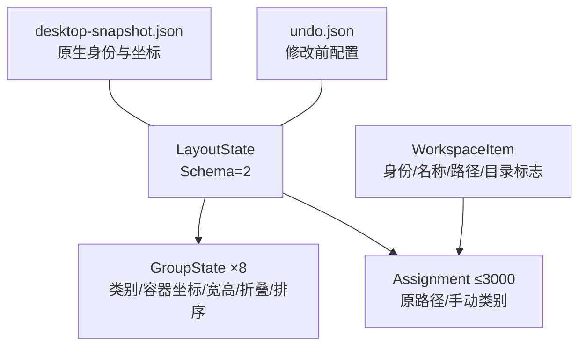
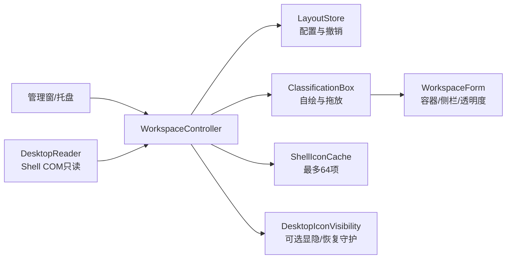

# Windows 桌面分类框与效率组件技术方案

## 1. 修订记录
| 版本 | 日期 | 修订内容 |
|---|---|---|
| v0.1 | 2026-10-11 | Python + PySide6 初始设计 |
| v0.2 | 2026-10-13 | 低内存优先，C# + WinForms 原型 |
| v0.5 | 2026-10-13 | L2：无边框统一工作区，桌面层驻留，宿主失效安全收起 |
| v0.4 | 2026-10-13 | L3：统一容器侧栏、两级排版、半透明、可选图标隐藏与恢复守护 |
| v0.3 | 2026-10-13 | 按牢大确认改为桌面分类框，不再以原生图标排序为主路线 |

## 2. 需求背景
### 2.1 现状
只读原型可扫描桌面，但不具备分类框；移动文件或直接改变原生图标布局不符合最新目标。
### 2.2 需求分析
- 桌面挂分类框，框内显示相应文件入口；安全 > 低内存 > 视觉效果。
- 目标 Windows10/11 x64、普通权限、Framework4.8；不含 ARM、32位、Explorer 注入。
- 当前交付：类型分类、框内打开、跨框手动分类、框移动 / 缩放 / 折叠、持久化、单步撤销。
- 后续：名称 / 时间 / 自定义规则与规则集、自动整理、待办、便签、快速启动栏。
- 不搬文件、不删除原件、不默认隐藏系统图标；旧 Python 草稿保留。

## 3. 概要设计
### 3.1 设计思路

| 决策 | 当前实现 | 边界 |
|---|---|---|
| 技术栈 | C#5、WinForms、Framework4.8、Release x64 | 无第三方运行库，无 WebView / ORM |
| 分类框 | 一个桌面层工作区、8个内部子窗，每框统一绘制 | 侧栏全局操作，不是每文件一个控件 |
| 桌面驻留 | 无边框工作区挂载到同Explorer进程的DefView | 普通应用覆盖；挂载失败安全收起；Win+D/真实重启待验收 |
| 原生图标 | 默认保留；主动/启动选项隐藏 | 原状态保护、独立守护；真实显隐恢复待验收 |
| 图标 | 按扩展名共享，程序快捷方式按路径；缓存最多64 | 按需 STA 工作线程，用完退出，无缩略图 |
| 持久化 | 固定 DTO + DataContract JSON | 无 BinaryFormatter、无数据库 |
| 生命周期 | 默认关闭退出；可见分类框 / --tray 保留托盘 | 收起框复用最多8个隐藏窗；显式退出释放所有资源 |
| 样式 | 清晰字号、圆角、整个工作区Opacity五档、默认100% | 文字图标一起透明，不是独立背景磨砂 |

### 3.2 数据关系

路径采用大小写无关比较；移动 / 重命名后需要重新扫描，暂不以文件ID追踪跨路径身份。
布局坏文件回退默认，读取 / 写入限1MiB；类别枚举、数量、尺寸、重复身份均校验。

### 3.3 系统交互

无远程 API、服务端接口或数据库；所有数据在本机用户目录。

## 4. 详细设计
### 4.1 模块
| 模块 | 职责 |
|---|---|
| Windows/DesktopReader | Shell 枚举名称 / parsingName / 坐标；最多3000项，释放PIDL / COM |
| Core/Classification | 安全过滤、类型分类、手动归属覆盖、去重与名称排序 |
| Core/LayoutStore | layout / undo / desktop-snapshot，原子保存、坏配置回退 |
| Core/WorkspaceController | 分组、框生命周期、撤销、位置重置、反馈与统一资源释放 |
| UI/ClassificationBox | 可见网格、打开、私有跨框拖放、拖动缩放、折叠、滚动 |
| UI/WorkspaceForm | 无边框桌面层容器、侧栏、整体拖动/缩放、透明度与高对比回退 |
| Windows/DesktopIconVisibility | 图标显隐、恢复守护握手；不写原生坐标 |
| Windows/ShellIconCache | 按需 STA 提取，克隆 Icon，DestroyIcon原生句柄，有限缓存 |
| UI/Theme / SurfaceDrawing | 独立配色、圆角、按钮状态、细滚动条、高对比回退 |

### 4.2 分类与规则
| 层级 | 当前行为 | 后续扩展 |
|---|---|---|
| 手动归属 | 跨框拖放写入Assignment，优先于默认类型 | 可按规则集保存 |
| 自定义规则 | 尚未实现 | 前缀、关键词、扩展名、文件夹名；按优先级首条匹配 |
| 默认类型 | 文档 / 图片 / 视频 / 安装包 / 压缩 / 程序快捷方式 / 文件夹 / 其他 | 保持兜底 |
| 时间分类 | 尚未实现 | 创建时间；最近使用优先记录本工具主动打开时间，不依赖NTFS LastAccess |
程序 `.exe` 不猜测用途，一律归入程序快捷方式；安装包识别 `.msi/.msix/.appx/.msixbundle`。
隐藏 / 系统 / 只读 / 重解析点 / 虚拟 Shell / UNC 项不进入分类框，扫描列表仍可展示。
只读属性的文件夹也跳过；不把保护项当空桌面，更不删除原件。

### 4.3 布局与撤销
- 第一次显示某次扫描结果前保存其原生坐标快照；不写入原生桌面。
- 每次拖动开始、缩放、折叠、手动分类、默认位置重置前保存undo；备份失败拒绝修改。
- 拖动 / 缩放结束保存；窗口大小限制220–2000 × 140–2000；展开高度与折叠状态分别保存。
- 保存同目录tmp并Flush，已有文件原子替换；无主程序磁盘轮询或保存计时器。
- 撤销先保存目标配置再更新UI；支持跨重启读回最近修改，重复撤销幂等，无多级历史。
- 「恢复框位置」只重置框；「重新按类型」清除手动归属；二者都能撤销。
- 打开路径只由用户双击 / Enter触发，失败非模态反馈；不自动执行配置内容。

### 4.4 工作区与原生图标恢复
- 无边框统一工作区驻留桌面层；分类框为内部子窗；DesktopAttachment复用并验证原生父子关系，不回退遮挡应用的浮窗。
- 隐藏默认关闭，用户主动按钮或保存启动选项；启动选项仅成功显示工作区后执行一次。
- 枚举Shell进程的桌面视图与原生列表，校验句柄/进程/类名；只切换列表显隐，不改图标坐标或Explorer样式。
- 先启动独立恢复进程并握手；隐藏失败请求恢复，恢复未确认保留守护并提示人工处理。
- 收起/退出恢复本次隐藏；原来已隐藏不强制显示。异常退出守护尝试恢复，真实效果待验收。
- Explorer重启不操作失效句柄、不自动重隐藏；Win10、多屏混合DPI仍待实机验证。
- 不实现原生坐标排序或位置恢复；日志、权限、配置错误继续走已有安全回退。

### 4.5 低内存与后续组件
- 主窗保留最多3000项，只绘制最多100条可见行；五段静态文案共享绘制并暴露辅助技术文本节点；分类框只绘制可见网格。
- 字体集中共享，动态反馈保留Label，关闭管理窗仍销毁；GDI资源及时Dispose。
- 图标最多64项；普通扩展名共享，不驻留扫描线程、不生成缩略图、不引入持续动画。
- 收起框复用隐藏窗口以减少50次开关堆增长；退出释放框、菜单、缓存、字体、托盘。
- 不使用GC.Collect、工作集裁剪；Private Bytes / Working Set / CPU / GDI / USER分别报告。
- 自动整理默认关闭：后续单定时器、去重与合并事件，重分类不搬文件，重入保护；自启用户主动开。
- 待办 / 便签 / 启动栏后续独立Widget模块；只创建启用的组件，可拖动 / 隐藏 / 移除。
- 半透明已实现顶层Opacity；高对比强制不透明；动画未实现、不常驻渲染循环。

| 场景 | Private Bytes目标 | 状态 |
|---|---|---|
| 按需退出 | 0MiB，本进程结束 | 默认未开框关闭退出已测 |
| 纯托盘 | ≤35MiB | 短测不等于长采样验收 |
| 主窗500项 | ≤70MiB | 500项列表功能已验；生产预算未验 |
| 三组件 | ≤90MiB | 组件尚未实现 |
| 整理峰值 | ≤120MiB | 完整场景未验证 |
| 50次开关增量 | ≤5MiB，句柄稳定 | 统一工作区隔离短测+3.12MiB；历史主窗短测最高4.93MiB，正式门禁待验 |
门禁：Release x64、固定环境、预热2分钟后10分钟100ms采样，至少3轮；DPI / 系统分别报告。
同时观察Explorer / DWM，GPU尚未采集；不能把隔离测试进程数字当生产常驻占用。

## 5. 任务拆解与验证
| 阶段 | 交付 | 状态 / 剩余估时 |
|---|---|---|
| P0 | 只读扫描、原生安全边界、圆角可读UI | 已实现；正式跨系统与内存门禁待验证 |
| P1 | 分类框、手动归属、持久化、撤销 | 初版57项回归通过；驻留兼容验收8–12小时 |
| P2 | 自定义规则 / 规则集 / 时间分类 | 未实现，4–8小时 |
| P3 | 自动整理、自启与异常恢复 | 未实现，6–10小时 |
| P4 | 三小组件与主题完善 | 半透明已实现，组件未实现，10–16小时 |
| P5 | 打包、干净Win10/11、多屏 / DPI与长采样 | 待实机验收，8–12小时 |
估时是计划区间；不把自动化模拟拖放当实际物理拖放 / 多系统验收。
AI负责代码 / 编译 / 隔离回归；牢大确认隐藏原生图标等危险设置，并参与实际桌面兼容验收。
证据：~/.agents/evidence/桌面整理工具/分类框-20261013-1791887728/（原始路径与截图不提交）。
证据：~/.agents/evidence/桌面整理工具/接续开发-20261013-1791892303/接续开发验证-20261013.md

## 7. 大容器升级（2026-10-13，L3）
- v0.4历史：统一普通工作区；v0.5改为桌面层驻留，8框仍为容器内子窗。
- 侧栏：分类框网格排版、所有项目名称排版、撤销、桌面图标显隐、启动隐藏选项、透明度。每框标题另有排版入口。
- 半透明使用顶层窗口 Opacity，0% / 25% / 50% / 75% / 100%、默认100%；文字与图标也透明，不宣称背景独立磨砂。高对比强制不透明。
- Schema2保存透明度、启动隐藏、每框排序开关；Schema1读取后迁移为容器局部坐标，原分类归属保留。
- 隐藏仅在工作区成功显示后执行，仅操作 Explorer 原生图标列表；不修改文件或图标坐标。默认关闭。
- 首次隐藏前启动独立恢复守护进程并握手；正常收起/退出恢复，仅原先可见的列表由本实例恢复。原先隐藏的不改。
- 守护进程等待本实例退出，异常退出尝试恢复原句柄；Explorer重启后不操作失效句柄，也不自动再次隐藏。
- 评审：复用既有模块，无新依赖；变更核心UI，回退自测。透明内容可读性、真实Explorer恢复与Win10/多屏为验收门禁。

## 8. 无边框桌面层（2026-10-13，L2）
- 影响WorkspaceForm、WorkspaceController、DesktopAttachment；复用既有分类/显隐模块，无新依赖。
- FormBorderStyle.None、无任务栏项；侧栏顶部拖动、下方缩放；整体几何本期不落配置。
- HWND直接创建在已存在、同Explorer进程的DefView下；先准备宿主再创建内部分类框，避免SetParent跨DPI重置。
- 显示不抢前台；只操作自己的窗口父子关系，不改变Explorer样式，不通过高频Z序轮询实现底层。
- 透明度更新先隐藏再恢复挂载；自身HWND重建后恢复canvas与内部框原生父子关系。
- 2秒宿主健康检查，失效尝试重建自身窗口；恢复失败安全收起并提示，不回退普通浮窗，不自动重隐藏图标。
- 评审：通过，P0=0；回退只需旧版exe，无配置升级；真实Explorer重启/Win+D/多屏为待验收项。
- 既有77项、原生同源诊断87项通过；普通应用覆盖检查、自身句柄重建与透明切换验证通过。
证据：~/.agents/evidence/桌面整理工具/桌面底层-20261013-1791897888/桌面底层验证-20261013.md

## 9. 五档不透明度与视觉升级（2026-10-14，L2）
- 不透明度改固定按钮，仅点击时保存并应用；移除滑条预览链路，避免拖动引发连续窗口重建。
- 0%含文字与图标完全透明；托盘菜单始终保留五档入口，高对比仍强制实际100%。
- Schema2范围扩展到0~100、仅保存25的倍数；旧滑条值读取时取最近档位，保留布局与归属。
- 工作区28px、分类框24px圆角；主窗工作台扩大圆角，Windows支持时请求原生圆角。
- 中性灰青浅深主题；操作按钮采用轻量文字样式，主入口和选中档位保留强调色与键盘焦点。
- 分组窗格Logo提供SVG/PNG/多尺寸ICO，嵌入exe并复用到托盘、窗口、管理页与侧栏。
- 编译与隔离UI预览通过；五档切换保留桌面挂载。未运行单元测试，实际频闪与多屏待用户验收。
证据：~/.agents/evidence/桌面整理工具/UI升级-20261014-1791907873/preview-log.txt

## 10. 应用自动分类（2026-10-14，L2）
| 项目 | 设计 |
|---|---|
| 分类 | 新增娱乐、聊天、设计、远程、下载、安全、工具、浏览器、文档/阅读；保留文件类型分类 |
| 娱乐二级 | 音乐、影视、游戏、社交，分类框内分区显示；手动拖入的未知项显示其他 |
| 识别 | 名称精确别名 → LNK目标文件名 → 本地EXE产品名/描述；URL独立按HTTP(S)域名匹配 |
| 优先级 | 持久化手动归属优先；自动结果扫描时缓存，重置/撤销不重复读取程序信息 |
| 兜底 | 未覆盖、坏链接和未知网站归入程序与快捷方式·待分类，不做模糊猜测 |
| 兼容 | 原有枚举0~23不变，新内置类别追加24~32；Schema2保持，分组上限由枚举总数确定 |
| 安全 | 不启动目标、不保存快捷方式、不上传信息；限制链接大小，不访问UNC目标及EXE重解析点 |
| 验证 | Release x64警告视为错误通过；82项隔离烟测通过，未运行既有项目单元测试 |
| 待验收 | 真实桌面应用覆盖率、鼠标分区拖放、多屏DPI；不自动替换正在运行的旧版 |
证据：~/.agents/evidence/桌面整理工具/应用分类-20261014-1791978982/应用分类验证-20261014.txt
